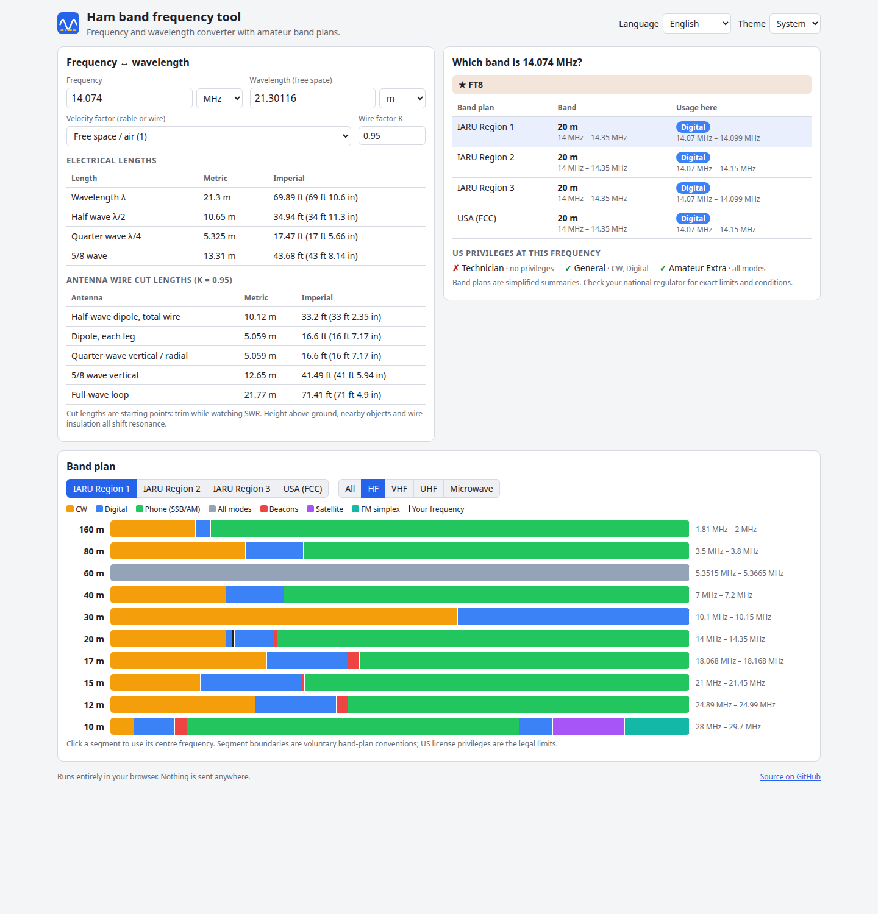

# Ham Band & Frequency Tool

Convert between frequency and wavelength, get antenna and cable lengths with a velocity factor, and see at a glance which amateur radio band a frequency belongs to. Band plans for IARU Region 1, 2 and 3 and the US (FCC) show the mode segments from HF to millimetre waves, with a US license-class filter. Everything runs in your browser.

**Try it: [hermes98761234.github.io/ham-band-frequency-tool](https://hermes98761234.github.io/ham-band-frequency-tool/)**

[](https://github.com/hermes98761234/ham-band-frequency-tool/actions/workflows/deploy.yml)



## Features

- **Frequency ↔ wavelength**, editable from either side. Type `14.074`, `7074k` or `2.4G`; wavelengths accept m, cm, mm, ft and in. Results are shown in metric and imperial.
- **Velocity factor.** Presets for common coax, ladder line and twin-lead, or enter your own. Electrical half-wave, quarter-wave and 5/8-wave lengths follow.
- **Antenna cut lengths.** Half-wave dipole (total and per leg), quarter-wave vertical or radial, 5/8 vertical and a full-wave loop, with an adjustable wire factor K.
- **"Which band is this frequency?"** The answer for all four band plans at once: the band, its edges, the mode segment, and well-known frequencies such as FT8, FT4, WSPR, QRP calling, beacons, FM calling and APRS.
- **Band plan charts** for IARU Region 1, 2, 3 and the USA, split into HF, VHF, UHF and microwave, with colored CW, digital, phone, beacon, satellite, FM, repeater and weak-signal segments. Click a segment to load its frequency.
- **US license class filter.** Pick Technician, General or Amateur Extra to dim what you may not use, or hide bands you cannot use at all. The lookup also lists the privileges of each class at the current frequency.
- **English or Ukrainian, light, dark or system theme.** Settings are remembered in the browser. No backend, no tracking.

## How it works

Wavelength is `λ = c · VF / f` with `c = 299 792 458 m/s`. Dipole and vertical cut lengths are `λ/2 · K` and `λ/4 · K`, where `K` (default 0.95) models the end effect of a wire antenna. The full-wave loop uses the usual 1005 / f(MHz) feet rule.

Band plans live in `src/lib/bands.ts` as plain data: contiguous segments per band, plus a table of US privileges per license class. Lookups, privilege checks and the chart all read the same data. The logic is covered by unit tests: textbook wavelengths, band edges per region, segment integrity, and license privileges at boundary frequencies.

The band plans are simplified summaries of the IARU and ARRL plans, and national rules vary. Check your regulator for exact limits. The US tables cover Technician, General and Amateur Extra (legacy Novice and Advanced classes are not included).

## Quick start

You need [Node.js](https://nodejs.org/) 22.

```bash
git clone https://github.com/hermes98761234/ham-band-frequency-tool.git
cd ham-band-frequency-tool
npm install
npm run dev       # http://localhost:5173
npm test          # unit tests
npm run build     # static site in dist/
```

## License

MIT
